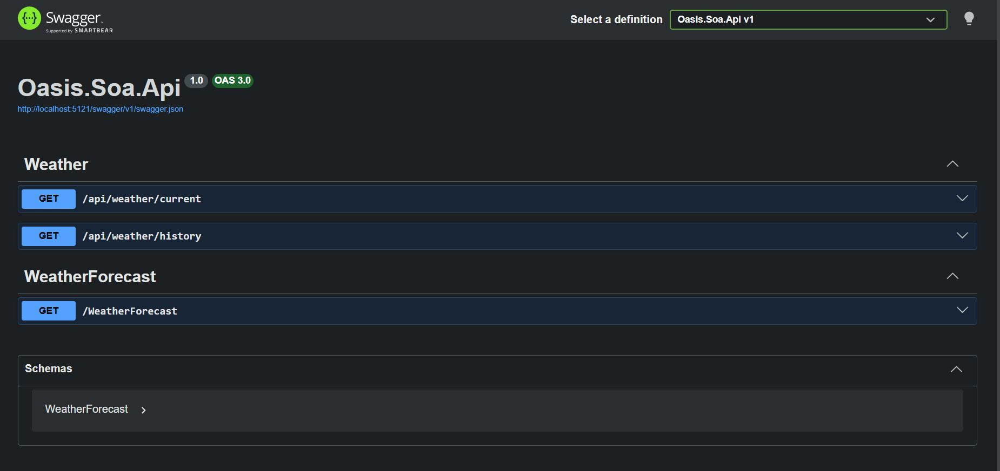
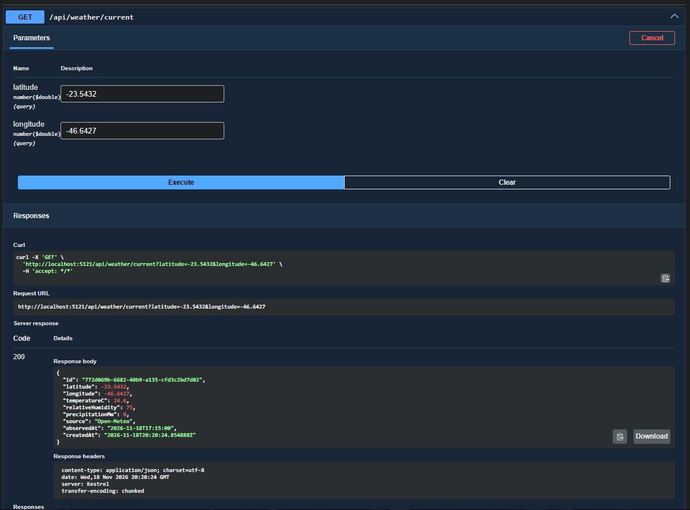
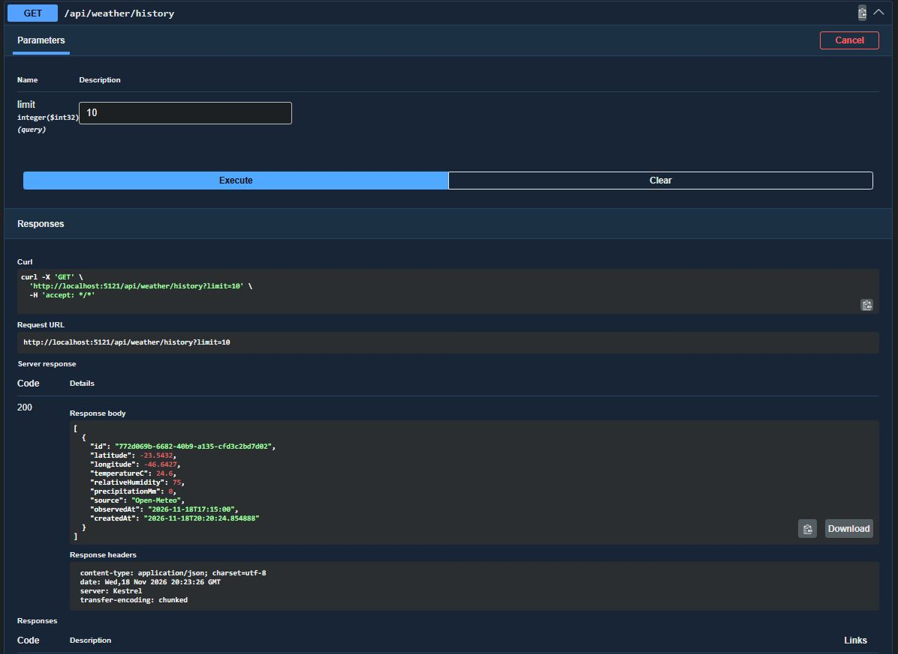
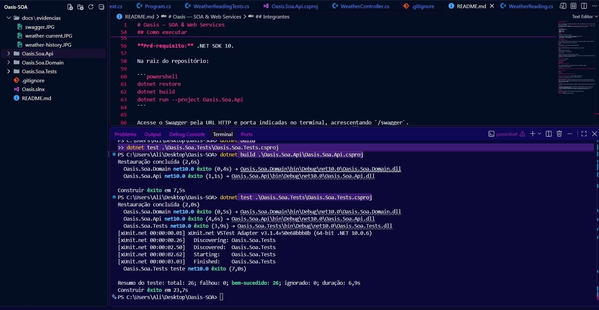

# Oasis — SOA & Web Services

**Global Solution 2026 — FIAP | CitizenTech**

**Disciplina:** Arquitetura Orientada a Serviços (SOA) e Web Services  
**Curso:** Engenharia de Software  
**Instituição:** FIAP  
**Ano:** 2026
---

## 1. Sobre o projeto

O **Oasis** é uma solução CitizenTech desenvolvida para a Global Solution 2026 da FIAP, com foco na proteção da população diante de eventos de calor extremo e na promoção de cidades mais resilientes.

A proposta consiste em um ecossistema tecnológico capaz de disponibilizar informações sobre condições meteorológicas, alertas de calor e pontos de proteção urbana, como locais com sombra, acesso à água e estabelecimentos que possam oferecer abrigo.

A região da Praça da República, em São Paulo, foi utilizada como referência territorial para o desenvolvimento e a demonstração da solução.

Este repositório corresponde à entrega da disciplina **Arquitetura Orientada a Serviços (SOA) e Web Services**.

O módulo é responsável por consultar informações meteorológicas reais, disponibilizá-las por meio de uma API REST e armazenar o histórico das consultas em um banco de dados relacional.

---

## 2. Ficha CitizenTech

| Campo | Descrição |
|---|---|
| **Nome do projeto** | Oasis |
| **Tema** | CitizenTech — Cidades inteligentes e resilientes |
| **Problema identificado** | Exposição da população ao calor extremo em áreas urbanas, especialmente em locais com pouca sombra, dificuldade de acesso à água e ausência de informações acessíveis sobre condições meteorológicas e pontos de proteção. |
| **Local de referência** | Região da Praça da República, São Paulo — SP |
| **Público-alvo** | Pedestres, trabalhadores, idosos, pessoas em situação de vulnerabilidade e cidadãos expostos a altas temperaturas. |
| **Objetivo geral** | Apoiar a população durante eventos de calor extremo, facilitando o acesso a informações meteorológicas, alertas e locais de proteção. |
| **Solução proposta** | Ecossistema digital com APIs REST, consulta meteorológica, histórico de condições climáticas, alertas de calor e identificação de pontos de proteção urbana. |
| **Módulo desta entrega** | Arquitetura Orientada a Serviços (SOA) e Web Services |
| **Funcionalidade implementada** | Integração com a Open-Meteo para consulta de temperatura, umidade e precipitação, com armazenamento em SQLite e disponibilização por endpoints REST. |
| **Tecnologias** | C#, .NET 10, ASP.NET Core, Entity Framework Core, SQLite, Swagger, Open-Meteo e xUnit |
| **Impacto esperado** | Ampliar o acesso a informações que auxiliem a população na tomada de decisões durante períodos de calor intenso. |
| **ODS relacionados** | ODS 3 — Saúde e Bem-Estar; ODS 11 — Cidades e Comunidades Sustentáveis; ODS 13 — Ação Contra a Mudança Global do Clima |
| **Status** | Protótipo acadêmico funcional, com integração meteorológica, persistência, documentação e testes automatizados. |

### 2.1. Problema e justificativa

A exposição ao calor extremo representa um desafio para a saúde pública e a mobilidade urbana. Em regiões com grande circulação de pedestres, a ausência de informações acessíveis sobre as condições meteorológicas e os locais de proteção pode aumentar a vulnerabilidade da população.

O Oasis propõe utilizar tecnologia para apoiar decisões cotidianas, disponibilizando informações úteis para cidadãos que precisam circular pela cidade em condições de calor intenso.

### 2.2. Contribuição do módulo SOA

O módulo SOA atua como serviço de integração meteorológica do ecossistema Oasis.

Por meio de uma API REST, a aplicação consulta dados da Open-Meteo, registra as informações em um banco SQLite e disponibiliza endpoints para consumo por outras aplicações.

A arquitetura permite separar as responsabilidades entre a integração meteorológica, os serviços de proteção urbana e as interfaces utilizadas pelos cidadãos.

---

## 3. Objetivos

### Objetivo geral

Desenvolver um serviço REST capaz de integrar dados meteorológicos externos ao ecossistema Oasis, com persistência e disponibilização das informações para outras aplicações.

### Objetivos específicos

- Desenvolver uma API REST utilizando ASP.NET Core.
- Implementar uma arquitetura organizada em camadas.
- Integrar um serviço externo de dados meteorológicos.
- Consultar temperatura, umidade relativa e precipitação.
- Persistir os dados utilizando Entity Framework Core e SQLite.
- Implementar migrations para versionamento do banco de dados.
- Disponibilizar documentação interativa com Swagger/OpenAPI.
- Implementar testes automatizados utilizando xUnit.
- Permitir a integração com outros módulos do ecossistema Oasis.

---

## 4. Tecnologias utilizadas

| Tecnologia | Finalidade |
|---|---|
| C# | Linguagem de programação |
| .NET 10 | Plataforma de desenvolvimento |
| ASP.NET Core | Desenvolvimento da API REST |
| Entity Framework Core 10 | Mapeamento objeto-relacional e persistência |
| SQLite | Banco de dados relacional |
| Open-Meteo API | Serviço externo de dados meteorológicos |
| Swagger / OpenAPI | Documentação e testes interativos da API |
| Swashbuckle.AspNetCore | Geração da documentação Swagger |
| xUnit | Testes automatizados |
| Git e GitHub | Versionamento e publicação do código |

---

## 5. Arquitetura da solução

O projeto utiliza uma arquitetura modular, organizada em três projetos .NET.

### 5.1. Oasis.Soa.Api

Camada responsável pela exposição dos endpoints HTTP, integração com serviços externos e acesso ao banco de dados.

Principais componentes:

- `WeatherController.cs`: disponibiliza os endpoints meteorológicos.
- `OpenMeteoService.cs`: realiza as requisições à API Open-Meteo.
- `OasisWeatherDbContext.cs`: configura o acesso ao SQLite por meio do Entity Framework Core.
- `Migrations/`: contém o histórico de evolução do banco de dados.
- `Program.cs`: configura os serviços, dependências e middleware da aplicação.

### 5.2. Oasis.Soa.Domain

Camada responsável pela representação das entidades de domínio.

A entidade `WeatherReading` representa uma consulta meteorológica, contendo:

- Identificador único.
- Latitude e longitude.
- Temperatura em graus Celsius.
- Umidade relativa do ar.
- Precipitação em milímetros.
- Fonte dos dados.
- Data e horário da observação.
- Data e horário do registro.

O modelo também possui validações para coordenadas geográficas e valores meteorológicos.

### 5.3. Oasis.Soa.Tests

Projeto responsável pelos testes automatizados com xUnit.

Os testes verificam as propriedades e regras de validação da entidade `WeatherReading`.

### 5.4. Fluxo de funcionamento

```text
Cliente HTTP / Swagger
         |
         v
WeatherController
         |
         v
OpenMeteoService
         |
         v
Open-Meteo API
         |
         v
Dados meteorológicos
         |
         v
OasisWeatherDbContext
         |
         v
Banco SQLite
         |
         v
Resposta HTTP / JSON
```

Na consulta de histórico, o controller acessa diretamente o contexto de dados para recuperar os registros armazenados.

---

## 6. Estrutura do projeto

```text
Oasis-SOA/
|
|-- docs/
|   |-- evidencias/
|       |-- swagger.JPG
|       |-- weather-current.JPG
|       |-- weather-history.JPG
|       |-- testes.JPG
|
|-- Oasis.Soa.Api/
|   |-- Controllers/
|   |   |-- WeatherController.cs
|   |
|   |-- Data/
|   |   |-- OasisWeatherDbContext.cs
|   |
|   |-- Migrations/
|   |
|   |-- Services/
|   |   |-- OpenMeteoService.cs
|   |
|   |-- appsettings.json
|   |-- Program.cs
|   |-- Oasis.Soa.Api.csproj
|
|-- Oasis.Soa.Domain/
|   |-- Models/
|       |-- WeatherReading.cs
|
|-- Oasis.Soa.Tests/
|   |-- WeatherReadingTests.cs
|   |-- UnitTest1.cs
|
|-- .gitignore
|-- Oasis.slnx
|-- README.md
```

Os arquivos temporários de compilação e o banco SQLite local não são versionados.

---

## 7. Integração com a Open-Meteo

A API utiliza o serviço externo **Open-Meteo** para consultar dados meteorológicos com base em coordenadas geográficas.

**Serviço utilizado:** https://open-meteo.com/

### 7.1. Informações consultadas

| Campo | Descrição |
|---|---|
| `temperatureC` | Temperatura em graus Celsius |
| `relativeHumidity` | Umidade relativa do ar em porcentagem |
| `precipitationMm` | Precipitação em milímetros |
| `latitude` | Latitude da localização consultada |
| `longitude` | Longitude da localização consultada |
| `observedAt` | Data e horário da observação meteorológica |
| `source` | Identificação da fonte dos dados |

A integração utiliza `HttpClient` e operações assíncronas.

Após a consulta, os dados são armazenados no SQLite para permitir a recuperação do histórico.

A disponibilidade dos dados depende do funcionamento do serviço externo.

---

## 8. Endpoints da API

### 8.1. GET /api/weather/current

Consulta as condições meteorológicas atuais para uma localização e registra a consulta no banco de dados.

**Parâmetros:**

| Parâmetro | Tipo | Obrigatório | Descrição |
|---|---|---|---|
| latitude | double | Sim | Latitude entre -90 e 90 |
| longitude | double | Sim | Longitude entre -180 e 180 |

**Exemplo de requisição:**

```http
GET /api/weather/current?latitude=-23.5432&longitude=-46.6427
```

**Exemplo de resposta real obtida durante os testes:**

```json
{
  "id": "772d069b-6682-40b9-a135-cfd3c2bd7d02",
  "latitude": -23.5432,
  "longitude": -46.6427,
  "temperatureC": 24.6,
  "relativeHumidity": 75,
  "precipitationMm": 0,
  "source": "Open-Meteo",
  "observedAt": "2026-11-18T17:15:00",
  "createdAt": "2026-11-18T20:20:24.854888Z"
}
```

**Possíveis respostas HTTP:**

- `200 OK`: consulta realizada com sucesso.
- `400 Bad Request`: coordenadas ausentes ou inválidas.
- `502 Bad Gateway`: falha na consulta ao serviço meteorológico externo ou resposta inválida.

### 8.2. GET /api/weather/history

Retorna os registros meteorológicos armazenados no SQLite, ordenados pela data de criação.

**Parâmetros:**

| Parâmetro | Tipo | Obrigatório | Descrição |
|---|---|---|---|
| limit | int | Não | Quantidade de registros, entre 1 e 100. Padrão: 20 |

**Exemplo de requisição:**

```http
GET /api/weather/history?limit=10
```

**Exemplo de resposta:**

```json
[
  {
    "id": "772d069b-6682-40b9-a135-cfd3c2bd7d02",
    "latitude": -23.5432,
    "longitude": -46.6427,
    "temperatureC": 24.6,
    "relativeHumidity": 75,
    "precipitationMm": 0,
    "source": "Open-Meteo",
    "observedAt": "2026-11-18T17:15:00",
    "createdAt": "2026-11-18T20:20:24.854888"
  }
]
```

**Possíveis respostas HTTP:**

- `200 OK`: histórico recuperado com sucesso.
- `400 Bad Request`: limite fora do intervalo permitido.

---

## 9. Banco de dados e migrations

O projeto utiliza **SQLite** com **Entity Framework Core** para persistência dos registros meteorológicos.

A entidade `WeatherReading` é mapeada para a tabela `WeatherReadings`.

A migration `InitialCreate` cria a estrutura inicial do banco, incluindo:

- Tabela `WeatherReadings`.
- Chave primária `Id`.
- Campos meteorológicos e geográficos.
- Índice na coluna `ObservedAt`.
- Histórico de migrations do Entity Framework Core.

### 9.1. Aplicar migrations manualmente

```powershell
dotnet ef database update --project Oasis.Soa.Api --startup-project Oasis.Soa.Api --context OasisWeatherDbContext
```

O projeto também está configurado para aplicar migrations pendentes durante a inicialização da API em ambiente de demonstração.

O banco SQLite é gerado localmente e não precisa ser enviado ao GitHub.

---

## 10. Como executar o projeto

### 10.1. Pré-requisitos

- .NET SDK 10.
- Visual Studio Code ou Visual Studio.
- Conexão com a internet para consultar a Open-Meteo.
- Ferramenta `dotnet-ef` para executar migrations manualmente, quando necessário.

### 10.2. Clonar o repositório

```powershell
git clone https://github.com/AliAndrea1/GS-CitizenTech-SOA.git
cd GS-CitizenTech-SOA
```

### 10.3. Restaurar dependências

```powershell
dotnet restore
```

### 10.4. Compilar a solução

```powershell
dotnet build
```

### 10.5. Iniciar a API

```powershell
dotnet run --project Oasis.Soa.Api
```

A aplicação será iniciada na porta configurada pelo ambiente.

Durante os testes locais, a API foi executada em:

```text
http://localhost:5121
```

### 10.6. Acessar o Swagger

Com a aplicação em execução, acesse:

http://localhost:5121/swagger

Caso a porta seja diferente, utilize o endereço informado no terminal.

A interface Swagger permite visualizar e executar os endpoints disponíveis.

---

## 11. Testes automatizados

Os testes foram desenvolvidos com **xUnit** e verificam as regras de validação da entidade meteorológica.

Entre os cenários cobertos estão:

- Geração automática de identificador.
- Fonte meteorológica padrão.
- Registro da data de criação.
- Aceitação de coordenadas geográficas válidas.
- Rejeição de coordenadas inválidas.
- Validação de temperaturas.
- Validação de umidade relativa.
- Rejeição de precipitação negativa.
- Aceitação de precipitação igual a zero.

### 11.1. Executar os testes

Na raiz do projeto:

```powershell
dotnet test .\Oasis.Soa.Tests\Oasis.Soa.Tests.csproj
```

### 11.2. Resultado da execução

**Data:** 18/11/2026

| Indicador | Resultado |
|---|---|
| Total de testes | 26 |
| Testes aprovados | 26 |
| Testes com falha | 0 |
| Testes ignorados | 0 |

Todos os testes executados foram aprovados.

Os testes automatizados concentram-se no modelo de domínio. O funcionamento dos endpoints e da persistência foi verificado manualmente por meio do Swagger.

---

## 12. Integração com o ecossistema Oasis

O módulo SOA foi desenvolvido para integrar o ecossistema Oasis por meio de serviços REST.

A solução separa as responsabilidades dos módulos.

### Oasis — C# Software Development

Responsável pelo cadastro e consulta de pontos de proteção urbana, busca por proximidade e análise demonstrativa de alertas de calor.

### Oasis — SOA & Web Services

Responsável pela integração meteorológica, disponibilização de dados reais e persistência do histórico de consultas.

### Oasis — Mobile Development & IoT

Aplicação cliente destinada à consulta das informações disponibilizadas pelos serviços do ecossistema.

Essa organização permite o reaproveitamento dos serviços e evita a duplicação de responsabilidades entre as aplicações.

---

## 13. Evidências de funcionamento

As evidências estão disponíveis no diretório `docs/evidencias/`.

### 13.1. Documentação Swagger

Interface Swagger/OpenAPI demonstrando os endpoints REST do módulo meteorológico.



### 13.2. Consulta meteorológica

Execução do endpoint `GET /api/weather/current`, demonstrando a integração com a Open-Meteo e o retorno dos dados meteorológicos.



### 13.3. Histórico meteorológico

Execução do endpoint `GET /api/weather/history`, demonstrando a recuperação dos dados previamente armazenados no SQLite.



### 13.4. Testes automatizados

Execução dos testes xUnit, demonstrando os 26 testes aprovados.



---

## 14. Considerações sobre os dados

Os dados meteorológicos são fornecidos pela Open-Meteo e podem variar conforme o horário da consulta.

O campo `observedAt` representa o horário local retornado pelo serviço meteorológico, enquanto `createdAt` registra o momento de criação do registro pela aplicação.

A precipitação representa a quantidade de chuva informada pelo serviço e não deve ser interpretada como probabilidade de chuva.

O projeto possui finalidade acadêmica e não substitui comunicados oficiais de órgãos meteorológicos ou da Defesa Civil.

---

## 15. Integrantes

| Nome | RM |
|---|---|
| Ali Andrea | 558052 |
| Guilherme Linard | 555768 |
| Lucas Vasquez | 555159 |

**Instituição:** FIAP  
**Curso:** Engenharia de Software  
**Projeto:** Global Solution 2026 — CitizenTech  
**Disciplina:** Arquitetura Orientada a Serviços (SOA) e Web Services  
**Ano:** 2026

---
